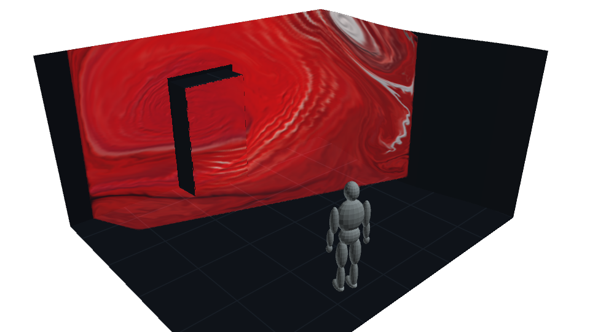
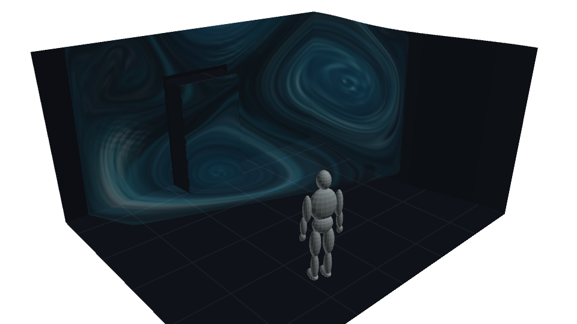
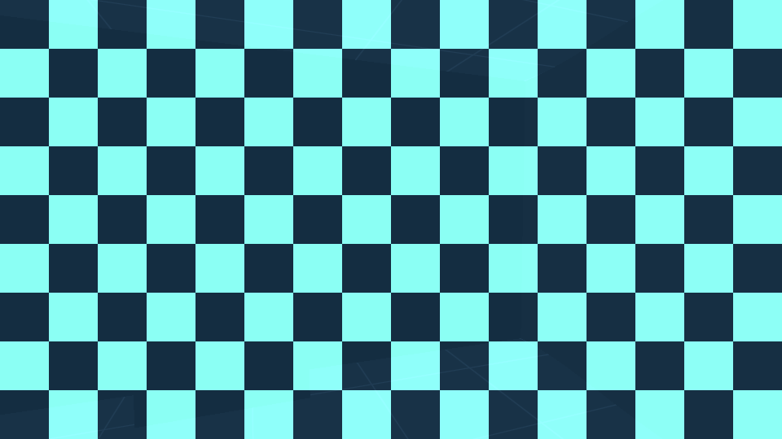
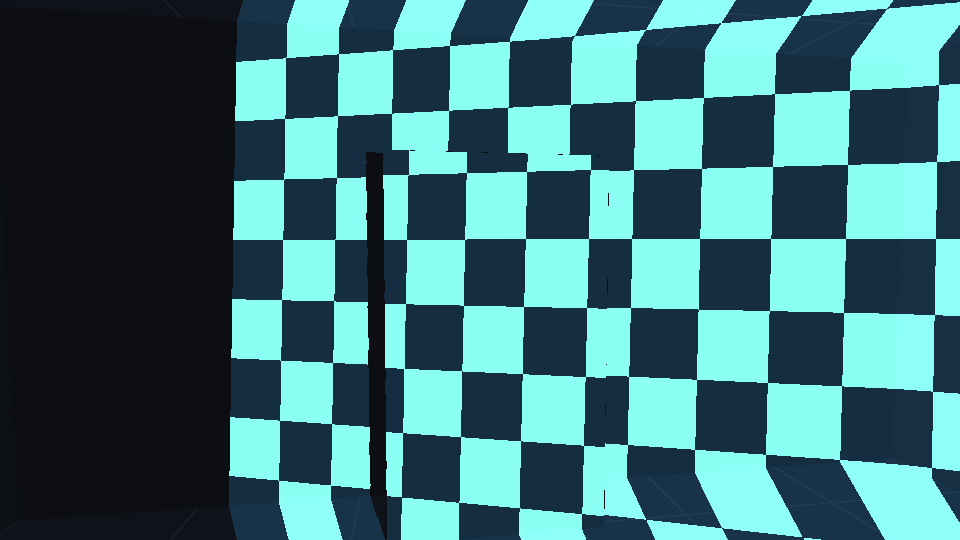
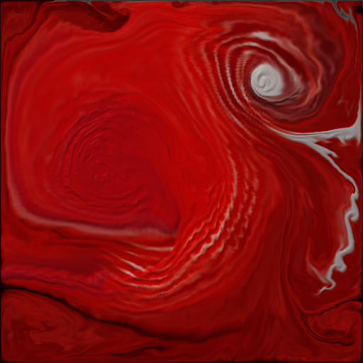

<!-- _class: cover -->

Prototype progress

# Anamorphic Fluid Room

A room-scale image that responds to voice and keeps moving through silence.

Intensity palette audition in TouchDesigner

16 October 2026

<!--
Speaker notes:
This is a progress review of the working virtual prototype, not a photograph of a physical projection installation. The cover shows the Intensity palette audition. Recorded implementation and test evidence dates from 13 October 2026.
Sources: ../README.md; ../assets/refined_room.png; repository commit 8a322e5372098724cccbc71efe64deabe0b8b952.
-->

---

## The virtual room is working

- **6 × 5 × 3 metre room** with a sharp corner, inward curve and protrusion.
- **Movable mannequin** with eye-level and orbit inspection.
- **Live microphone input** changes the fluid and its palette.
- **Editable Blender asset** accompanies the native TD project.

<figure>

<figcaption>Third-person cutaway reveals the geometry and viewing position.</figcaption>
</figure>

The current prototype previews ideal mapped imagery. Physical projector calibration comes later.

<!--
Speaker notes:
The cutaway is for inspection. The scene still models an enclosed room. The live room uses native procedural TouchDesigner surfaces so dimensions remain adjustable. Blender and glTF use the same geometry definition. Arbitrary Blender mesh edits do not sync automatically into TD.
Sources: ../README.md; ../src/room_geometry.py; ../assets/blender_validation.json; ../assets/delivered_room.png.
-->

---

## Alignment depends on the sweet spot

One fixed projection camera aligns the image across uneven surfaces.

<figure>

<figcaption><strong>At the sweet spot</strong> The checkerboard reads as a continuous grid.</figcaption>
</figure>
<figure>

<figcaption><strong>After moving away</strong> The room geometry becomes visible through distortion.</figcaption>
</figure>

Moving the person leaves projection alignment fixed. “Set sweet spot here” re-anchors the image without resetting the fluid.

<!--
Speaker notes:
The shader derives projective coordinates from each surface's world position. A reference depth map excludes room surfaces hidden from the sweet spot. A staged pixel check found 100% agreement with the intended checker at sampled pixels at the sweet spot and after re-anchoring, versus 57.4% off axis. This is a virtual image comparison, not a physical calibration-accuracy measurement.
Sources: ../assets/alignment_validation.json; ../assets/alignment_sweet.png; ../assets/alignment_off_axis.png; ../src/room_pixel.glsl.
-->

---

## The audio-to-image pipeline

<table class="pipeline">
<thead><tr><th>Step</th><th>Stage</th><th>What it contributes</th></tr></thead>
<tbody>
<tr><td>01</td><td>Microphone analysis</td><td>RMS loudness and confidence-filtered fundamental pitch.</td></tr>
<tr><td>02</td><td>Emotional mapping</td><td>Continuous weights for Calm, Wonder, Joy and Intensity.</td></tr>
<tr><td>03</td><td>GPU fluid simulation</td><td>Voice adds force and ink to persistent idle circulation.</td></tr>
<tr><td>04</td><td>Colour mapping</td><td>The palette changes across existing pigment as well as new ink.</td></tr>
<tr><td>05</td><td>Room projection</td><td>The sweet spot aligns imagery. Independent cameras inspect it.</td></tr>
</tbody>
</table>

TouchDesigner embeds the shaders, Python callbacks and interface in one working TOE file.

<!--
Speaker notes:
The project separates audio, emotion, fluid, room, projection, viewing and interface components. YIN estimates pitch rather than selecting the loudest FFT bin. The GPU solver uses a fixed 1/60-second step per project frame, floating-point textures, 12 viscosity iterations and 24 pressure iterations. The existing TDMCP connection allowed Python to build and inspect real TD operators. TDMCP and Codex are not required to run the saved artwork.
Sources: ../src/audio_emotion.py; ../src/runtime.py; ../tools/build_td_room.py; ../tools/refine_fluid.py; ../README.md.
-->

---

## Mood follows the character of the voice

<table class="moods">
<thead><tr><th>Artistic mood</th><th>Acoustic tendency</th><th>Palette direction</th><th>Movement direction</th></tr></thead>
<tbody>
<tr><td class="calm">Calm</td><td>Quiet, lower pitch</td><td>Deep blue and teal</td><td>Gentle circulation</td></tr>
<tr><td class="wonder">Wonder</td><td>Quiet, higher pitch</td><td>Indigo and lavender</td><td>Delicate curls</td></tr>
<tr><td class="joy">Joy</td><td>Louder, higher pitch</td><td>Coral and gold</td><td>Faster swirls</td></tr>
<tr><td class="intensity">Intensity</td><td>Louder, lower pitch</td><td>Burgundy and red</td><td>Denser streams</td></tr>
</tbody>
</table>

These names describe the artwork’s expression. They do not identify the speaker’s emotions. Neighbouring moods blend continuously.

<!--
Speaker notes:
Loudness and logarithmic pitch define the mood coordinates. The latest palette uses perceptual OKLab mixing and pale-ink concentration. Movement descriptions express the intended character of the shared continuous solver, rather than four separate simulations. The Intensity treatment moved toward red and pale ink during the fluid refinement.
Sources: ../src/audio_emotion.py; ../src/palette.glsl; ../src/force.glsl; ../README.md.
-->

---

## The fluid now holds finer detail

<figure>

<figcaption>Refined solver capture in Intensity audition.</figcaption>
</figure>

### Recent improvements

- Curl forces help retain rolling eddies.
- Corrected pigment transport preserves thin trails.
- Pale ink folds into coloured pigment.
- Viscosity stays separate from drag and colour fading.

<!--
Speaker notes:
The earlier prototype produced broad, smooth colour fields. The refinement added vorticity confinement, multiscale stirring, pressure history and locally clamped MacCormack pigment transport. The visual direction draws from the Refractiv reference shared during development. This is an independently implemented approximation of that direction, not an exact reproduction.
Sources: ../tools/refine_fluid.py; ../src/pigment_correct.glsl; ../src/vorticity.glsl; ../assets/refined_intensity.png.
Visual reference: https://www.instagram.com/p/DMsZkRgsG5n/?img_index=1
-->

---

<!-- _class: performance -->

## Measured prototype performance

≈60 FPS

512 × 512 fluid on an RTX 4060 Laptop GPU

<table>
<thead><tr><th>View</th><th>Average</th><th>Minimum*</th></tr></thead>
<tbody>
<tr><td>Comparison</td><td>60.02</td><td>59.32</td></tr>
<tr><td>First person</td><td>60.08</td><td>59.95</td></tr>
</tbody>
</table>

### Recorded checks

- **65.6 seconds** of below-gate idle with finite, bounded fluid data.
- **Tone tests** resolve within one semitone across the tested speech range.
- **Higher viscosity** reduces velocity-field variation by about 29%.
- **Camera movement** preserves the fixed projection anchor.

Recorded 13 Oct 2026 in TouchDesigner 2025.33230. *Minimum sampled, smoothed project FPS. These short runs do not establish installation endurance or performance with physical projector outputs.

<!--
Speaker notes:
The refined idle report contains 64 samples. Comparison: 33 samples, mean 60.0233 FPS, minimum 59.3204 FPS. First person: 31 samples, mean 60.0844 FPS, minimum 59.9538 FPS. Mean pigment density ranged roughly 0.24–0.48. Pressure projection reduced divergence on every sample, averaging around 13.7%. The viscosity comparison held the test field and drag constant and measured spatial gradient RMS. Speech-tone checks used synthetic harmonic signals at three levels. In-room human humming remains a calibration check. Native saves and live operator checks passed, while a final independently confirmed cold reopen and longer unattended run remain sensible handoff checks.
Sources: ../assets/refined_fluid_validation.json; ../assets/speech_colour_validation.json; ../assets/viscosity_validation.json; ../assets/alignment_validation.json; ../assets/speech_colour_delivery.json.
-->

---

## Next checks on a real site

01

<h3>Measured room geometry</h3>
Replace the example room with a clean, dimensioned mesh and agree on the intended viewing position.

02

<h3>Voices in the actual space</h3>
Calibrate the noise floor, try different speakers and test how room acoustics affect pitch confidence.

03

<h3>Projector coverage and calibration</h3>
Check throw, surface brightness, overlapping coverage and the shadows cast by visitors.

04

<h3>Installation endurance</h3>
Confirm a cold reopen, microphone recovery and longer unattended operation with the final output setup.

Physical projection and real-person tracking remain outside this virtual prototype.

<!--
Speaker notes:
These are proposed next checks, not completed work. The saved native project, editable Blender file, glTF companion and source code already exist. The current person is a manually controlled virtual mannequin. A Gaussian splat could add visual context for a site, while clean scaled meshes remain useful for projection and collision surfaces.
Sources: ../README.md; project scope and acceptance plan in the development conversation.
-->

---

<!-- _class: closing -->
<!-- _paginate: false -->

## Live Demo
